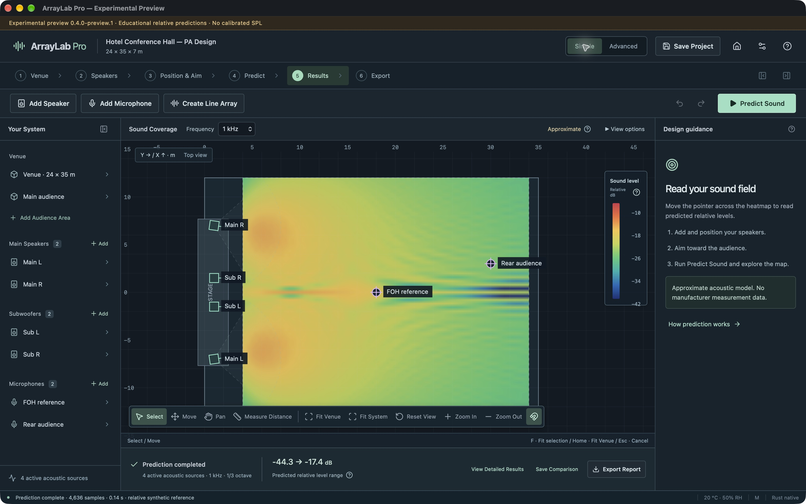
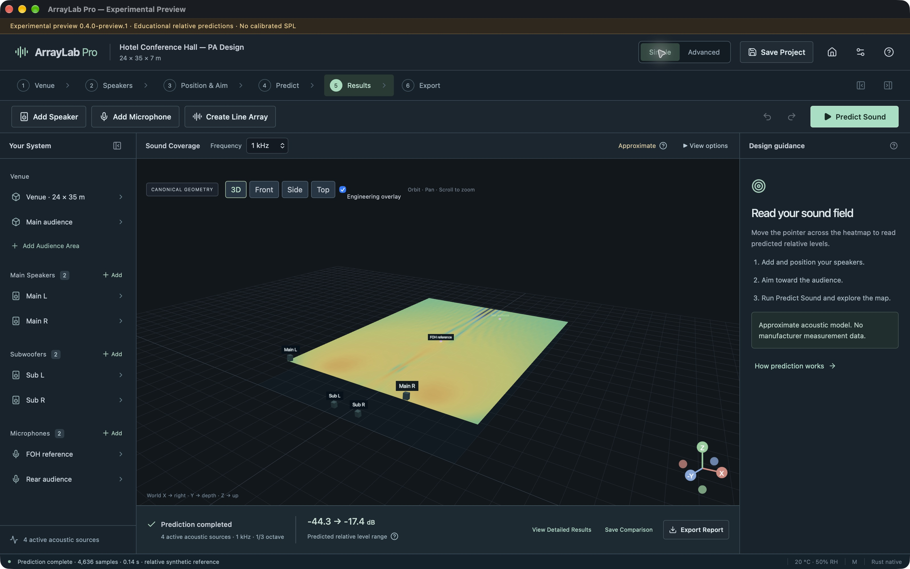
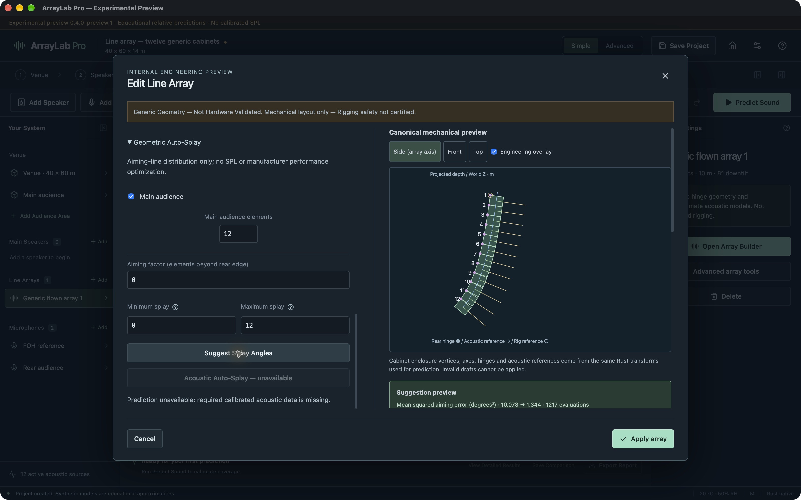
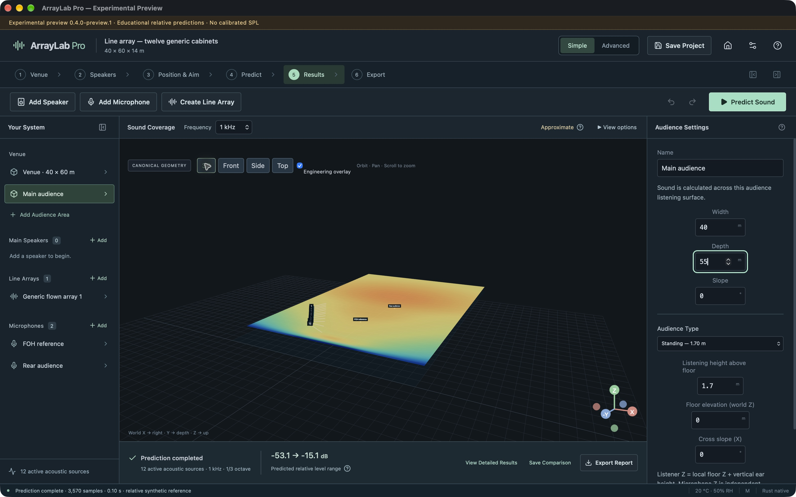

# Beta user guide

**Experimental software — not validated for professional sound-system design, certified rigging, or safety-critical decisions.**

[Download version 0.4.0-preview.1](https://github.com/srdjankotarlic/ArrayLab-Pro-Releases/releases/tag/v0.4.0-preview.1) · [SHA-256 checksums](https://github.com/srdjankotarlic/ArrayLab-Pro-Releases/releases/download/v0.4.0-preview.1/SHA256SUMS.txt)

## Install

Download the installer for your CPU from the published prerelease and compare its SHA-256 with SHA256SUMS.txt. Mac: open the DMG, drag ArrayLab Pro to Applications, then open it in Finder. Preserve an older copy first. This preview is ad-hoc signed and not notarized; macOS may require a per-app allowance in Privacy & Security if you trust the verified download. Never disable Gatekeeper globally. The owner's Desktop copy also launches directly.

Windows x64: run the NSIS Setup.exe, complete the current-user installation and open ArrayLab Pro from Start. The installer includes WebView2 dependency handling; no Node, Rust or Python is needed. The unsigned preview may trigger SmartScreen. Use an individual-app choice only after verifying the source/hash; do not disable protection globally. Uninstall through Windows Installed Apps. Check the release notes for actual Windows runtime evidence; physical interactive QA is pending.

## First prediction

1. Choose New Project. Select a venue and enter width, length and height in meters. Choose seated (1.20 m), standing (1.70 m) or a custom ear height. Audience floor elevation and ear height are separate; balcony floor height is added to the ear offset.
2. Choose a generic system and Open Designer. In Simple mode follow Venue → Speakers → Position & Aim → Predict → Results → Export.
3. Add Speaker, select a generic acoustic model, then click the venue. Drag to move, or select it and enter exact XYZ/angles. Aim at audience lets you click a target. Data provenance identifies the actual source model.
4. For an array, use Create Line Array. Choose Generic Geometry — Not Hardware Validated; set count, grid height/orientation, attachment and discrete splay. The preview shows actual canonical cabinets. Invalid geometry is rejected. Geometric Auto-Splay: press Suggest, inspect the aiming-error proposal, then Use suggestion in preview to fill the draft fields and Apply array to commit. Reject suggestion discards the proposal; Cancel closes the builder without committing its draft.
5. Choose frequency/band and Predict Sound. The heatmap uses actual calculated listener samples. Relative dB shows model differences; it cannot establish absolute SPL. Changing geometry, DSP or environment makes an old result stale until Predict runs again.
6. Add Microphone and click a listening point. Microphone Z is a global coordinate. Frequency Response and Advanced Measurements show magnitude, phase, group delay and the band-limited impulse. Phase may be unavailable at a cancellation or across incoherent groups. Save a trace to compare with later measurements.
7. Advanced mode exposes exact settings, environment, array geometry, filters, routing groups, measurements and reports. Gain/delay/polarity/mute/EQ affect the actual model. Simple/Advanced changes preserve project state.
8. Save Project or Cmd/Ctrl+S. First save defaults to Documents and chooses a .arraylab path; later native saves overwrite that same path atomically. File → Save As or Cmd/Ctrl+Shift+S creates another file. Open validates files; schema 1 migration requires review and preserves the original. Undo/Redo restores project edits. Edit Copy/Paste/Duplicate creates new object IDs and offsets copies along X; array spacing clears the selected cabinet envelope. Select the whole array to copy it. Other collisions and project limits are explicitly rejected.
9. Use Export or Advanced → Reports for PDF, field PNG, equipment/array CSV and measurement/reference exports. Technical values come from current state. A stale map is not exported as current.
10. If a session closes unexpectedly, reopen and choose Restore autosave. Recent Projects opens local snapshots. Keep durable disk copies for important work.

## Demo studies

The app bundle includes conference, standing concert, mixed audience/balcony, twelve-cabinet array, delay alignment and three-subwoofer interference projects. Matching templates are available on the welcome screen. Change frequency, positions, splay, delays and polarity, then recalculate. Every source is generic or analytical, without fabricated manufacturer data.

## Feedback

Help → Report a Bug / Request a Feature / About ArrayLab Pro opens support. Engineering discrepancies have a dedicated issue form. Provide version, OS, function, model/dataset, exact reproduction steps, expected versus actual behavior and, if permitted, a minimal project/measurement reference. The form opens in a browser; nothing is submitted or attached automatically. Remove confidential venue/customer information from optional attachments.

See the actual installed Mac screenshots below.

## Actual Mac screenshots

The following captures are from the installed Apple Silicon desktop app using its bundled generic conference project and native Rust engine (0.4.0-preview.1). They are application screenshots, not accuracy benchmarks.

This proposal screenshot uses the generic twelve-cabinet study. The score measures aiming-line geometry only; it is not calibrated acoustic coverage or hardware validation.

